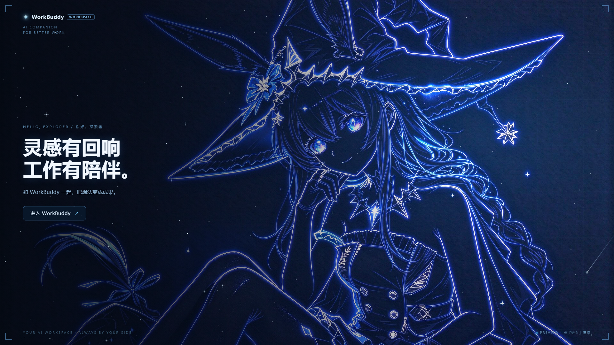

# 阿米娅-星海寻梦-workbuddy-splash

> WorkBuddy 风格开屏特效：深蓝海洋开场 → 蓝色光刃自上而下擦除（PPT 翻页式）→ 启屏页。

一个纯前端渲染的 Electron 开屏动画，可作为桌面应用的启动画面。

- **无网络依赖**：所有图形在本地渲染，不请求任何外部接口。
- **PPT 翻页式转场**：一条 2px 蓝色光刃自上而下划过，线上方是启屏页、下方是海洋，扫到哪揭到哪；沿线溅出蓝色水晶碎屑。
- **启屏页**：流星 / 星野 / 钻石星辰 Logo。
- **开箱即用**：`npm install && npm start`，或直接用「便携版」双击运行。

## 💡 懒人一键安装（把这整段复制给 WorkBuddy）

> 帮我装一下「阿米娅-星海寻梦」开屏特效（Electron 小工具）：
> 1) 打开 https://github.com/Muelsyse-520/workbuddy-splash ，在 Releases 里下载 `v1.0.0` 的 `workbuddy-splash-portable-win64.zip`；
> 2) 解压到 `F:\AI-Data\apps\amiya-starsea`（没有就新建）；
> 3) 打开解压目录里的 `resources\app\config.json`，把 `"target"` 改成 `"F:\\WorkBuddy\\WorkBuddy.exe"`；
> 4) 先备份桌面和开始菜单里的 WorkBuddy 快捷方式，再把它们的目标改成解压出来的 `WorkBuddy Splash.exe`（起始位置填解压目录）；
> 5) 装好后告诉我怎么验证：要**完全退出 WorkBuddy（含托盘）**，再从桌面或开始菜单启动，才会看到开屏。

复制上面这段发给 WorkBuddy 即可，它会替你下载、解压、改快捷方式。

## 🖼 效果预览




- **不装任何环境直接看**：打开 `preview/full-playthrough.html`，浏览器会自动完整播放。
- **桌面版**：见下方「快速开始 / 便携版」。

## 快速开始（源码运行）

需要 **Node.js 18+**。

```bash
npm install
npm start
```

- 全屏无边框播放；开场时**右下角有「跳过开屏」按钮**（或按 `Esc`），点击才跳过，点其他位置不会误关。
- 落到启屏页后点「进入」关闭，或 20 秒后自动关闭。
- 窗口模式：`npm start -- --windowed`。

## 便携版（免安装 Node）

解压 `workbuddy-splash-portable-win64.zip`，双击其中的 **`WorkBuddy Splash.exe`** 即可（Windows x64）。
无需 Node、无需 `npm install`。

## 配置 · `config.json`

```json
{
  "fullscreen": true,
  "width": 1280,
  "height": 720,
  "target": "",
  "maxWaitMs": 60000
}
```

| 字段 | 说明 |
|---|---|
| `fullscreen` | `true` 全屏无边框；`false` 时使用 `width` / `height` |
| `target` | 可选：首帧时并行拉起的程序路径（例如 `"C:\\Apps\\Foo\\Foo.exe"`）；留空则开屏结束后直接退出 |
| `maxWaitMs` | 兜底最长存活时间，防止卡住不退出 |

## 自定义

- **换主视觉**：替换 `renderer/splash-html/assets/hero-line.jpg`（建议 1920×1080）。
- **换文案 / 品牌**：编辑 `renderer/splash-html/index.html` 中 `#landing` 区块。
- **调节奏**：在 `index.html` 末尾的桥接层里：
  - `T_END` 开场结束秒数（当前 9.2）
  - `SWEEP_AT` 定格后多久起扫（0.05）
  - `SWEEP_MS` 光刃擦除时长（2000）
  - `HOLD_MS` 擦完停留（140）

## 目录结构

```
main.js                  Electron 主进程（窗口 / 淡出 / 可选拉起 target）
preload.js               桥接：向页面暴露 window.splashHost
config.json              配置
renderer/splash-html/
  index.html             开屏动画 + 蓝色光刃擦除 + 启屏页
  assets/hero-line.jpg   主视觉
preview/
  full-playthrough.html  浏览器直开版（自播放，无需安装）
```

## 分享 / 发布（拿到下载地址）

**方式一：GitHub（推荐，链接永久稳定）**
1. 新建仓库，把本目录内容全部上传（`.gitignore` 已排除 `node_modules`）。
2. 进入 `Releases` → `Draft a new release`，上传 `workbuddy-splash-portable-win64.zip`。
3. 发布后，该附件即得到一个稳定直链（形如 `https://github.com/<你>/<仓库>/releases/download/v1.0.0/...`）。

**方式二：网盘**
把 `workbuddy-splash.zip`（源码）或便携版 zip 上传到百度网盘 / 阿里云盘，分享链接即可。

**方式三：在线演示**
把 `preview/full-playthrough.html` 部署到任意静态托管（GitHub Pages / Vercel / Netlify），得到一个"点开就能看"的演示链接。

## 常见问题

- **双击 exe 没反应 / 闪退**：确认系统为 Windows x64；首次运行可能被 SmartScreen 拦截，点「更多信息 → 仍要运行」。
- **浏览器打开 `index.html` 只看到海洋、没有启屏页**：`index.html` 依赖 Electron 的 preload 桥接；纯浏览器预览请用 `preview/full-playthrough.html`。
- **想改动画**：入口是 `renderer/splash-html/index.html`，动画与转场全在里面。

## 许可

- 代码：MIT（见 `LICENSE`）。
- 演示素材 `assets/hero-line.jpg` 仅作演示，请替换为你拥有版权的图像。
